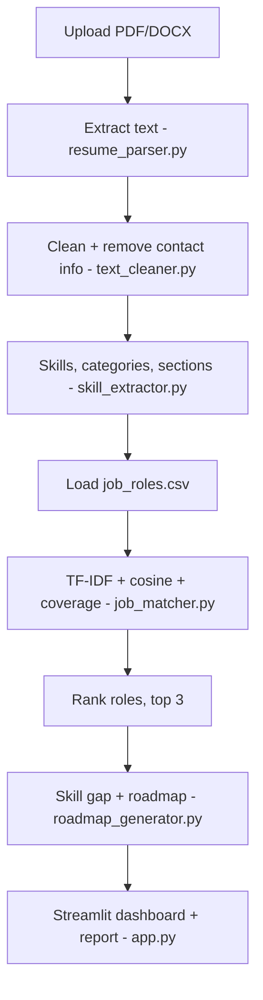

# AI Resume Analyzer and Job Recommendation System

NLP-based Streamlit app that scores a PDF/DOCX resume against job roles, lists missing skills and generates a learning roadmap.

## Features
Upload PDF/DOCX (type and size validated, processed in memory) - text extraction and cleaning (keeps C++, C#, .NET, CI/CD) - 80 skill dictionary with categories - 8 job roles - TF-IDF + cosine match score - top-3 role recommendations - skill gap (found / missing / weak) - rule-based weekly roadmap - match-score chart - downloadable report (.md) and scores (.csv).

## Workflow


## Setup
```bash
python -m venv venv && source venv/bin/activate      # Windows: venv\Scripts\activate
pip install -r requirements.txt
streamlit run app.py
```

## Tests
```bash
python make_samples.py        # creates sample_resumes/*.docx
python tests/run_tests.py     # writes tests/evaluation_sheet.csv
```

## Match score
`score = 70% x required-skill coverage + 30% x TF-IDF cosine similarity` (skills are tokens, so rare skills like MLflow weigh more than Python).
Extend by editing `data/job_roles.csv` (pipe-separated skills) and `data/skill_dictionary.csv` (aliases + roadmap task).

## Deployment (Streamlit Community Cloud)
1. Push to GitHub (`.env` is git-ignored). 2. share.streamlit.io - New app - select repo - main file `app.py`. 3. Deploy and copy the link.
Docker/Render: `pip install -r requirements.txt` then `streamlit run app.py --server.port $PORT --server.address 0.0.0.0`.

## Responsible AI
Guidance only, not hiring/rejection. Email, phone and URLs are stripped before analysis; no gender, age, religion, nationality, photo, marital status or disability is scored. Scores are estimates; a missing keyword does not always mean missing ability. Resumes are never written to disk.

## Limitations
Dictionary/keyword matching misses unlisted skills and synonyms; scanned PDFs need OCR; roles are a small manually written dataset. Upgrades: spaCy phrases, Sentence Transformers, job-description upload, LLM feedback, FastAPI + Docker.

## Still to do by you (deliverables)
Replace sample resumes with your own anonymised ones, add architecture diagram image (use the mermaid above), record the demo video, write the short report, push to GitHub and deploy.
